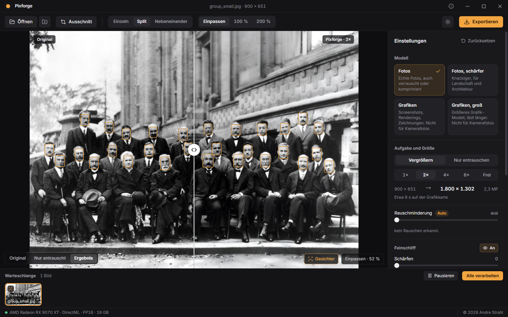

# Pixforge

Lokaler KI-Upscaler für Fotos auf Basis von **HAT** (Hybrid Attention Transformer).
Bild hineinziehen, Modell wählen, fertig. Alles läuft auf dem eigenen Rechner, ohne Konto
und ohne Telemetrie.

> **Version 1.0.0** – Windows-Installer unter
> [Releases](https://github.com/Absinth2k/pixforge/releases/latest).



*Beispielbild: Solvay-Konferenz 1927 (gemeinfrei), 900 px breit, links Original, rechts
Pixforge 2× mit Gesichtsverbesserung.*

## Für Anwenderinnen und Anwender

1. Unter [Releases](https://github.com/Absinth2k/pixforge/releases/latest)
   `Pixforge-Setup-<Version>.exe` herunterladen und starten.
2. Windows warnt beim ersten Mal „Der Computer wurde durch Windows geschützt“, weil der
   Installer nicht signiert ist: **Weitere Informationen → Trotzdem ausführen**.
3. Wählen, ob Pixforge nur für dich (ohne Adminrechte) oder für alle Benutzer installiert
   wird; der Ordner lässt sich ändern.
4. Beim ersten Start lädt Pixforge einmalig die KI-Modelle für deinen Rechner
   (etwa 370 MB mit Grafikkarte). Danach braucht es kein Internet mehr, außer für Updates.

Pixforge sucht sich die beste Grafikkarte selbst (NVIDIA, AMD oder Intel über DirectML) und
rechnet ohne passende Grafikkarte auf dem Prozessor, dann allerdings deutlich langsamer.
Updates kommen automatisch (abschaltbar unter ⓘ in der Titelleiste). Bilder verlassen den
Rechner nie, es gibt keine Telemetrie.

Voraussetzungen: Windows 10 oder 11 (64 Bit), 8 GB RAM; empfohlen eine Grafikkarte mit
mindestens 4 GB Speicher.

## Für Entwickler

Voraussetzungen: Windows 10/11, [uv](https://docs.astral.sh/uv/), Git, Node.js 22+.

```powershell
cd backend
uv sync --extra export --extra raw   # Python 3.12 venv inkl. PyTorch (CPU) für den Export
uv run pytest

cd ..\app
npm install
npm run dev          # startet Oberfläche und Backend zusammen
npm run test:e2e     # Smoke-Test der echten App (Electron + Backend + Modelle)
```

Installer bauen (Ausgabe `app/dist/Pixforge-Setup-<Version>.exe`):

```powershell
cd backend; uv sync --extra raw --group package   # einmalig
cd ..pp
npm run dist:backend   # Python-Backend einfrieren (PyInstaller) -> backend/dist/pixforge-server
npm run dist           # Installer (electron-builder, NSIS)
# gepackte App testen, ohne Python:
$env:PIXFORGE_PACKAGED="dist/win-unpacked/Pixforge.exe"; npx playwright test e2e/packaged.spec.ts
```

Release: Version in `app/package.json`, `backend/pyproject.toml` und
`backend/src/pixforge/__init__.py` erhöhen, Installer bauen, dann ein GitHub-Release
`v<Version>` mit `Pixforge-Setup-<Version>.exe`, `.exe.blockmap` und `latest.yml` anlegen
(die installierten Apps finden es über electron-updater). Modelle liegen im Release
`models-v1` (Vorabversion, damit der Updater es ignoriert).

Hinter einem HTTPS-prüfenden Virenscanner (z. B. Avast) vorher `UV_SYSTEM_CERTS=1` setzen.

### Kommandozeile

```powershell
uv run pixforge foto.jpg -o out                      # 4x mit „Fotos (Standard)“
uv run pixforge C:\Bilder --width 6000 --faces       # ganzer Ordner, Gesichter verbessern
uv run pixforge scan.tif --model clean --scale 2 --format tiff --bits 16
uv run pixforge --list-models                        # installierte Modelle
uv run pixforge --list-devices                       # gefundene GPUs
```

Weitere Optionen: `--denoise auto|off|on|0-100`, `--jpeg`, `--sharpen`, `--detail`,
`--grain`, `--face-model face-gfpgan`, `--pattern "{name}_{scale}_{model}"`,
`--exists rename|overwrite|skip`, `--device cpu|gpu:0`, siehe `pixforge --help`.

### Modelle konvertieren

Alle Modelle aus `backend/src/pixforge/models/models.json` auf einmal erzeugen (landen in
`%LOCALAPPDATA%\Pixforge\models`, Hashes werden in `models.json` eingetragen):

```powershell
uv run python -m pixforge.models.build --weights ..\weights
```

Einzelne Modelle:

Die Original-Gewichte (siehe `THIRD_PARTY.md`) liegen nicht im Repository. Konvertierung nach
ONNX, als FP32 oder gemischtes FP16 (für GPUs):

```powershell
uv run python -m pixforge.models.export_onnx hat ..\weights\hat\Real_HAT_GAN_SRx4.pth out\real_hat_gan_x4_fp16.onnx --fp16
uv run python -m pixforge.models.export_onnx scunet ..\weights\denoise\scunet_color_real_psnr.pth out\scunet_fp16.onnx --fp16
```

Prüfen und messen: `bench/verify_hat_onnx.py`, `bench/verify_restore_onnx.py`,
`bench/bench_hat.py`, `bench/bench_denoise.py`. Ergebnisse und Entscheidungen stehen in
[`docs/backend.md`](docs/backend.md).

## Aufbau

```
backend/   Python (Bildverarbeitung, ONNX Runtime, später FastAPI-Server und CLI)
app/       Electron + React + TypeScript (ab Etappe 4)
bench/     Mess- und Prüfskripte
docs/      Messungen, Design
```

## Lizenz

© 2026 Andre Strahl. Code: Apache-2.0 (siehe [`LICENSE`](LICENSE) und [`NOTICE`](NOTICE)).
Modelle und Bibliotheken von Dritten: siehe [`THIRD_PARTY.md`](THIRD_PARTY.md).
